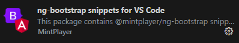

# @mintplayer/ng-bootstrap
# Demo
A complete demo application with all components is showcased [here](https://bootstrap.mintplayer.com)

## Version info

| License      | Build status | Code coverage |
|--------------|--------------|---------------|
| [](https://opensource.org/licenses/Apache-2.0) | [](https://github.com/MintPlayer/mintplayer-ng-bootstrap/actions/workflows/publish-master.yml) | [](https://coverage.mintplayer.com/github/r/MintPlayer/mintplayer-ng-bootstrap) |


| Package                      | Version |
|------------------------------|---------|
| @mintplayer/ng-animations    | [](https://badge.fury.io/js/%40mintplayer%2Fng-animations) |
| @mintplayer/ng-click-outside | [](https://badge.fury.io/js/%40mintplayer%2Fng-click-outside) |
| @mintplayer/ng-focus-on-load | [](https://badge.fury.io/js/%40mintplayer%2Fng-focus-on-load) |
| @mintplayer/ng-bootstrap     | [](https://badge.fury.io/js/%40mintplayer%2Fng-bootstrap) |
| @mintplayer/ng-qr-code     | [](https://badge.fury.io/js/%40mintplayer%2Fng-qr-code) |

## Installation

    npm i @mintplayer/ng-bootstrap

This should also install the peerDependencies in your project.

Now you should import the `bootstrap` stylesheet in the application. To do so, you have 2 options:

Update your `angular.json`:

    "styles": [
      "@mintplayer/ng-bootstrap/bootstrap.scss",
      "src/styles.scss"
    ],

Or add the stylesheet in your `styles.scss`

    @import '@mintplayer/ng-bootstrap/bootstrap.scss';

## Components
Every component is one framework-neutral TypeScript core in `@mintplayer/ui-core` (state, keyboard,
ARIA, async lifecycles), consumed by four fronts that each render their own HTML: Angular
(`@mintplayer/ng-bootstrap`), React (`@mintplayer/react-bootstrap`), Vue (`@mintplayer/vue-bootstrap`)
and Lit web components (`@mintplayer/web-components`, for apps without a framework). The Angular,
React and Vue components do **not** wrap or render a web component. Each component is showcased in
three sibling demo apps, one per framework.

### Run locally via the Nx dev server

| Framework | Lib                            | Dev server              | Command                            |
|-----------|--------------------------------|-------------------------|------------------------------------|
| Angular   | `@mintplayer/ng-bootstrap`     | <http://localhost:4200> | `npx nx serve ng-bootstrap-demo`    |
| React 19  | `@mintplayer/react-bootstrap`  | <http://localhost:4000> | `npx nx serve react-bootstrap-demo` |
| Vue 3.5   | `@mintplayer/vue-bootstrap`    | <http://localhost:4100> | `npx nx serve vue-bootstrap-demo`   |

All three can run simultaneously — the ports don't collide. The brand-mark links in each demo's top-right nav switch between them while preserving the current path.

To boot **all three demos + the .NET API at once** from a single terminal (one `dotnet watch` shared by all three; one Ctrl+C tears the whole tree down):

    npx nx run-many -t serve -p 'ng-bootstrap-demo,react-bootstrap-demo,vue-bootstrap-demo'

The single quotes around the project list are required on PowerShell — without them, `-p a,b,c` is parsed as PowerShell's comma-operator array and split into separate args, which Nx silently rejects with "No tasks were run".

Each demo's `serve` target lists the API serve as a dependency and is flagged `continuous: true`, so Nx folds the task graph into a single `api:serve` invocation instead of racing three of them for the same `bin/Debug/net10.0/` DLL locks.

The shorter `npm start -- --open` is wired to the Angular demo by default (see `scripts.start` in `package.json`).

### Playwright browsers

The e2e projects (`apps/*-bootstrap-demo-e2e`) run Chromium and Firefox; the React and Vue ones also run WebKit. Install all three once, with the Playwright version from `package.json`:

    npx playwright install chromium firefox webkit

Run e2e through Nx, e.g. `npx nx e2e vue-bootstrap-demo-e2e -- --project=webkit`.

## Styling and encapsulation

### Styles ship per component

A component brings its own CSS: its scoped stylesheet **and** the Bootstrap partial its markup uses
(`card`, `forms`, `table`, `modal`, …). The CSS is installed once per page when the component first
renders, and written into `<head>` during server rendering. An app that never renders a card bundles
none of `.card`. A component and its styles can ship in the lazy-loaded chunk of the page that uses
it, so the main bundle stays small.

Globally, an app loads only the **page-level** Bootstrap from the installation step above: root,
reboot, type, images, buttons, helpers and utilities. Do not import Bootstrap's component partials
into your global stylesheet.

**Raw Bootstrap markup of your own** (a `<table class="table">`, a `<div class="alert">`) is not styled
by a component's copy of the partial: that copy only matches elements a component rendered (see
Encapsulation). Install the partial from the page that renders the markup, so it rides that page's chunk:

```ts
import { bootstrapTablesPage } from '@mintplayer/ui-core/bootstrap/tables';
// Angular: useBootstrap(bootstrapTablesPage) in the page component's constructor
// React / Vue / plain TS: installBootstrap(bootstrapTablesPage)
```

A page never holds two copies of a partial: the page variant replaces a component's scoped copy.

### Encapsulation

The Angular, React and Vue components render in the light DOM, with no shadow root. Their own styles are
scoped at build time onto a `data-mps` attribute: the same device Angular's `ViewEncapsulation.Emulated`
uses for `_ngcontent`.

- **Your CSS reaches your content normally**, including content you render into a component (a row
  template, a cell renderer, a slot).
- **Page CSS also reaches the component's internals.** A global `td { padding: 0 }` affects these
  components too. This is deliberate: emulated encapsulation behaves the same way everywhere else.
- **The component's styles cannot leak out** onto your markup. Every rule is anchored to an element the
  build stamped, and conformance suites enforce this on every build. That includes the Bootstrap
  partials the components ship: their copy is scoped with `:where([data-mps])`, so your own `.card` or
  `.table` elsewhere on the page is untouched, and specificity stays exactly Bootstrap's.
- **Theming needs no `!important`.** Bootstrap sits in `@layer mp.bootstrap` and the component sheets
  in `@layer mp.components`, so your unlayered CSS beats both.

### Plain web components

Every `mp-*` element (`@mintplayer/web-components`) renders in the light DOM, so the page's CSS reaches
it. If you host one **inside your own shadow root**, adopt the document's component sheets into it, or
it renders unstyled:

```ts
import { adoptLightStyles } from '@mintplayer/web-components/light-dom';

connectedCallback() {
  super.connectedCallback();
  this.releaseStyles = adoptLightStyles(this.shadowRoot);
}
disconnectedCallback() {
  this.releaseStyles?.();
  super.disconnectedCallback();
}
```

## Docker image
Alternatively you can run the docker image which is published on GitHub Container Registry

    docker run -p 4200:80 ghcr.io/mintplayer/mintplayer-ng-bootstrap:master

and visit [http://localhost:4200](http://localhost:4200).

## Deployment
See [deployment documentation](DEPLOYMENT.md) for instructions on setting up automatic deployment to a VPS.

### SSR behind a reverse proxy (Angular)

All three demos are deployed with **request-time SSR**, so every component is real HTML in the response and the layout renders with JavaScript disabled. The Angular SSR server has two `@angular/ssr` security guards that must be configured for the public domain, or it silently falls back to **client-side rendering** (you get an HTTP `200` with an empty `<demo-bootstrap-root></demo-bootstrap-root>` shell — no server-rendered content):

1. **`NG_ALLOWED_HOSTS`** — the Host-header SSRF allow-list. Must contain the public domain (e.g. `bootstrap.mintplayer.com`). A *mismatch* here returns a hard `400`; an *empty* list falls back to CSR.
2. **`NG_TRUST_PROXY_HEADERS`** — the list of `x-forwarded-*` headers to trust. **This is the one that bit us in production.** `@angular/ssr` deopts to CSR for *any* incoming `x-forwarded-*` header it doesn't trust, and its default trusted set is only `x-forwarded-host` + `x-forwarded-proto`. Traefik also forwards `x-forwarded-for`, `x-forwarded-port`, and `x-forwarded-server`, so every proxied request silently deopted to CSR until these were trusted.

Both are set on the `ng-bootstrap` service in [`docker-compose.yml`](docker-compose.yml):

```yaml
environment:
  - "NG_ALLOWED_HOSTS=bootstrap.mintplayer.com"
  - "NG_TRUST_PROXY_HEADERS=x-forwarded-host,x-forwarded-proto,x-forwarded-for,x-forwarded-port,x-forwarded-prefix,x-forwarded-server"
```

Gotchas:

- **`NG_TRUST_PROXY_HEADERS=true` does not work.** The env value is comma-split into a list of header names, so `true` is read as a header literally named `true`. List the headers explicitly.
- **The React/Vue demos are unaffected** — their plain Express SSR servers have no host/proxy-header validation, which is why they kept rendering correctly while Angular did not.
- **Local `nx serve` / `node server.mjs` without a proxy works regardless**, because no `x-forwarded-*` headers are present — the deopt only manifests once a reverse proxy sits in front. To reproduce, replay the proxy headers against a production build:

  ```bash
  curl -s -o out.html -H "Host: bootstrap.mintplayer.com" \
    -H "X-Forwarded-Host: bootstrap.mintplayer.com" -H "X-Forwarded-Proto: https" \
    -H "X-Forwarded-For: 203.0.113.7" -H "X-Forwarded-Port: 443" \
    http://localhost:4000/overlays/shell
  # without NG_TRUST_PROXY_HEADERS → ~6.5 KB CSR shell; with it → full SSR + <template shadowrootmode>
  ```

## Fonts
The `<bs-icon>` uses fonts from bootstrap-icons which need to be included in the application. Since there's no `"assets"` field in an angular library its project configuration, we seem to have no other option than to explicitly tell the application to include them.

`angular.json` / `project.json`

    {
      "projects": {
        ...,
        "xxx": {
          ...,
          "architect": {
            "build": {
              "options": {
                ...,
                "assets": [
                  ...,
                  {
                    "glob": "*.woff|*.woff2",
                    "input": "node_modules/bootstrap-icons/font/fonts",
                    "output": "/fonts"
                  }
                ]
              }
            }
          }
        }
      }
    }

## VS Code snippets
This workspace contains several code snippets for [VS Code](https://code.visualstudio.com).
They are distributed on the [MarketPlace](https://marketplace.visualstudio.com/items?itemName=MintPlayer.mintplayer-ng-bootstrap-snippets) and can be installed by searching for **ng-bootstrap snippets for VS Code**

[](libs/mintplayer-ng-bootstrap-snippets/images/marketplace.png)

## Discover yourself
Make sure you have [NodeJS](https://nodejs.org/en/download/) installed.
Then run following commands

    git clone https://github.com/MintPlayer/mintplayer-ng-bootstrap
    npm i
    npm start -- --open

## Features
- Uses `@angular/cdk/overlay`
- Uses per-component styles. Only the page-level Bootstrap (root, reboot, type, buttons, helpers, utilities) is global; every component ships its own CSS
- One framework-neutral TypeScript core per component (`@mintplayer/ui-core`), with Angular, React, Vue and Lit web-component fronts that each render their own HTML (no front wraps a web component)
- Carousel: touch-events, keyboard navigation, full APG carousel ARIA
- Charts with **zero runtime dependencies**, under a nested `charts/*` subpath per framework (e.g. `@mintplayer/ng-bootstrap/charts/hierarchy`): a hierarchy chart with three interchangeable layouts (`sunburst` / `icicle` / `treemap`, drill-down and unbounded `max-depth="auto"`), a trend chart and a sparkline. Keyboard-operable and screen-reader navigable via the ARIA *tree* pattern
- Interactive no-JS support for **Navbar**, **Shell**, **Dropdown menu** and **Carousel** on server-rendered pages (server-rendered HTML + pure-CSS state machines) — works in all three framework demos
